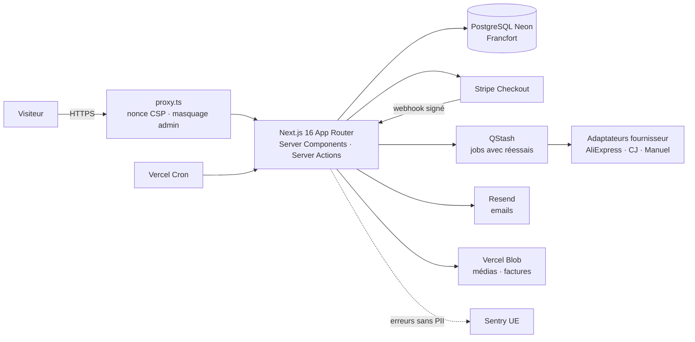

# Architecture

> Tenu à jour à chaque phase. Le détail du schéma de données et des flux validés est dans [`PHASE0_CADRAGE.md`](PHASE0_CADRAGE.md).

## Vue d'ensemble



## Choix techniques et justification

| Sujet                     | Choix                                                                                  | Pourquoi                                                                                                                                                 |
| ------------------------- | -------------------------------------------------------------------------------------- | -------------------------------------------------------------------------------------------------------------------------------------------------------- |
| Framework                 | Next.js 16.3, App Router, TypeScript strict                                            | Imposé ; Server Components et Server Actions gardent le métier côté serveur.                                                                             |
| Interception des requêtes | `src/proxy.ts` (remplace `middleware.ts` depuis Next 16)                               | Runtime Node, nonce CSP par requête, réécriture du chemin admin secret. Volontairement sans logique d'autorisation.                                      |
| ORM                       | Prisma 7.10 + `@prisma/adapter-pg`                                                     | Prisma 7 impose un driver adapter ; `pg` fonctionne à l'identique en local et sur Neon (connexion poolée). Prisma 8 est encore en RC : exclu.            |
| Connexions                | `DATABASE_URL` poolée (app), `DIRECT_URL` directe (migrations, via `prisma.config.ts`) | Le pooler transactionnel de Neon ne supporte pas toutes les opérations de migration.                                                                     |
| Validation                | Zod 4                                                                                  | Entrées, variables d'environnement (`src/server/env.ts`), réponses fournisseur.                                                                          |
| Auth admin                | Better Auth 1.7 (email + mot de passe + TOTP), sans route `/api/auth` exposée          | Auth.js v5 n'a jamais été stable et n'est plus que maintenu ; Better Auth fournit TOTP + codes de secours. Appels serveur uniquement : moins de surface. |
| Montants                  | Entiers en centimes                                                                    | Aucune erreur d'arrondi flottant sur les prix, remises et factures.                                                                                      |
| Styles                    | Tailwind CSS 4, polices auto-hébergées par `next/font`                                 | Aucune requête vers Google côté visiteur (RGPD, CSP stricte).                                                                                            |
| Monitoring                | Sentry v11, tunnel `/monitoring`, `dataCollection` restreint + `beforeSend`            | Aucune donnée personnelle envoyée ; CSP `connect-src 'self'` suffit.                                                                                     |
| Rendu                     | Toutes les pages dynamiques (le layout lit les en-têtes)                               | Condition pour qu'un nonce CSP neuf soit appliqué à chaque réponse.                                                                                      |
| Paquets                   | pnpm 11, versions exactes, `minimumReleaseAge` et scripts d'install bloqués par défaut | Réduit le risque d'attaque par la chaîne d'approvisionnement.                                                                                            |
| Région                    | Vercel `fra1` + Neon `eu-central-1`                                                    | Données en UE, latence minimale entre fonctions et base.                                                                                                 |

## Organisation du code

```
src/
├── proxy.ts               # nonce CSP + masquage admin
├── instrumentation*.ts    # Sentry
├── app/                   # routes (boutique, pages légales, admin interne, API)
├── lib/                   # code sans secret, partageable (CSP, routage admin, options Sentry)
├── server/                # code exclusivement serveur (`import "server-only"`) : env, db, métier
└── generated/prisma/      # client Prisma généré (non versionné)
```

Admin : pages internes sous `src/app/admin`, servies sous `/<ADMIN_PATH>` ; tout lien et redirection passe par `adminHref()`. Chaque page et action commence par `requireAdmin()`.

Règle : les Server Actions et routes ne font que **valider (Zod) → autoriser → appeler le métier** de `src/server/**`, écrit en fonctions testables.

## Fulfillment fournisseur (phase 5)

```mermaid
flowchart TD
    W[Webhook Stripe : commande payée] --> F[finalizePaidOrder]
    F --> Q[scheduleFulfillment<br/>QStash ou after()]
    Q --> D[fulfillOrder]
    C10[Cron 10 min : rattrapage] --> D
    D --> S{Offre suivante<br/>par priorité}
    S --> R[Réservation QUEUED → PLACING<br/>mise à jour conditionnelle]
    R --> A[Adaptateur<br/>AliExpress · CJ · Manuel]
    A -->|payée| P[PLACED + registre des achats]
    A -->|à payer| AP[AWAITING_SUPPLIER_PAYMENT + alerte]
    A -->|temporaire| RT[QUEUED + délai 1 min → 4 h]
    A -->|rupture / refus / 6 échecs| FB[FAILED → offre suivante + alerte<br/>+ email client si délai rallongé]
    A -->|incertain| NC[NEEDS_CHECK : jamais rejoué auto]
    A -->|non configuré| M[MANUAL_ACTION_REQUIRED + alerte]
    C60[Cron horaire : suivi] --> T[SHIPPED → email par colis<br/>DELIVERED → email]
    T --> RV[Cron quotidien : demande d'avis J+7]
```

| Choix                                                                                                                     | Pourquoi                                                                              |
| ------------------------------------------------------------------------------------------------------------------------- | ------------------------------------------------------------------------------------- |
| La base sert de file d'attente (`SupplierOrder` : statut, tentatives, prochaine échéance) ; QStash ne fait que déclencher | Rejouable, observable dans l'admin, aucun état perdu si QStash ou une fonction tombe. |
| Une commande fournisseur par article (= un colis)                                                                         | Bascule indépendante par taille ; multi-colis validé en phase 0 (Q11).                |
| Réservation par `updateMany(where status = QUEUED)`                                                                       | Deux exécutions simultanées ne peuvent pas envoyer la même commande (testé).          |
| Réponse incertaine → `NEEDS_CHECK`, jamais de renvoi automatique                                                          | Un doublon de commande fournisseur coûte plus cher qu'un traitement manuel.           |
| Jetons d'API stockés chiffrés (AES-256-GCM, `SECRETS_ENCRYPTION_KEY`) et renouvelés automatiquement                       | Les jetons sont des secrets ; ils tournent (AliExpress, CJ 180 jours).                |
| Coûts CJ en USD convertis avec un taux saisi dans l'admin                                                                 | Pas de taux codé en dur ni de service de change externe.                              |
| AliExpress : `try_to_pay` (paiement auto avec le moyen enregistré), désactivable                                          | Équivalent DSers ; sinon commande « à payer » signalée par email et dans l'admin.     |
| CJ hors production : `isSandbox=1`                                                                                        | Tests de bout en bout sans débit réel.                                                |
