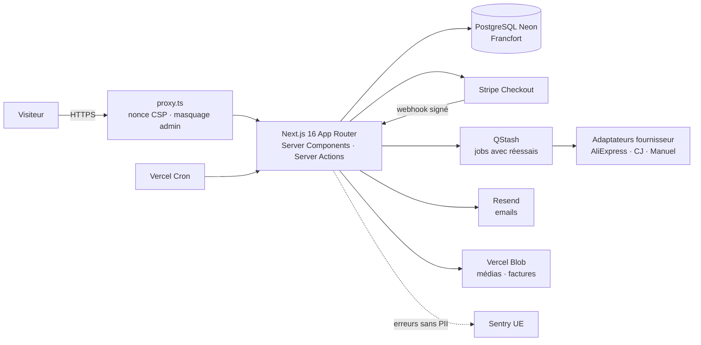

# Architecture

> Tenu à jour à chaque phase. Le détail du schéma de données et des flux validés est dans [`PHASE0_CADRAGE.md`](PHASE0_CADRAGE.md).

## Vue d'ensemble



## Choix techniques et justification

| Sujet                     | Choix                                                                                  | Pourquoi                                                                                                                                                 |
| ------------------------- | -------------------------------------------------------------------------------------- | -------------------------------------------------------------------------------------------------------------------------------------------------------- |
| Framework                 | Next.js 16.3, App Router, TypeScript strict                                            | Imposé ; Server Components et Server Actions gardent le métier côté serveur.                                                                             |
| Interception des requêtes | `src/proxy.ts` (remplace `middleware.ts` depuis Next 16)                               | Runtime Node, nonce CSP par requête, réécriture du chemin admin secret. Volontairement sans logique d'autorisation.                                      |
| ORM                       | Prisma 7.10 + `@prisma/adapter-pg`                                                     | Prisma 7 impose un driver adapter ; `pg` fonctionne à l'identique en local et sur Neon (connexion poolée). Prisma 8 est encore en RC : exclu.            |
| Connexions                | `DATABASE_URL` poolée (app), `DIRECT_URL` directe (migrations, via `prisma.config.ts`) | Le pooler transactionnel de Neon ne supporte pas toutes les opérations de migration.                                                                     |
| Validation                | Zod 4                                                                                  | Entrées, variables d'environnement (`src/server/env.ts`), réponses fournisseur.                                                                          |
| Auth admin                | Better Auth 1.7 (email + mot de passe + TOTP), sans route `/api/auth` exposée          | Auth.js v5 n'a jamais été stable et n'est plus que maintenu ; Better Auth fournit TOTP + codes de secours. Appels serveur uniquement : moins de surface. |
| Montants                  | Entiers en centimes                                                                    | Aucune erreur d'arrondi flottant sur les prix, remises et factures.                                                                                      |
| Styles                    | Tailwind CSS 4, polices auto-hébergées par `next/font`                                 | Aucune requête vers Google côté visiteur (RGPD, CSP stricte).                                                                                            |
| Monitoring                | Sentry v11, tunnel `/monitoring`, `dataCollection` restreint + `beforeSend`            | Aucune donnée personnelle envoyée ; CSP `connect-src 'self'` suffit.                                                                                     |
| Rendu                     | Toutes les pages dynamiques (le layout lit les en-têtes)                               | Condition pour qu'un nonce CSP neuf soit appliqué à chaque réponse.                                                                                      |
| Paquets                   | pnpm 11, versions exactes, `minimumReleaseAge` et scripts d'install bloqués par défaut | Réduit le risque d'attaque par la chaîne d'approvisionnement.                                                                                            |
| Région                    | Vercel `fra1` + Neon `eu-central-1`                                                    | Données en UE, latence minimale entre fonctions et base.                                                                                                 |

## Organisation du code

```
src/
├── proxy.ts               # nonce CSP + masquage admin
├── instrumentation*.ts    # Sentry
├── app/                   # routes (boutique, pages légales, admin interne, API)
├── lib/                   # code sans secret, partageable (CSP, routage admin, options Sentry)
├── server/                # code exclusivement serveur (`import "server-only"`) : env, db, métier
└── generated/prisma/      # client Prisma généré (non versionné)
```

Admin : pages internes sous `src/app/admin`, servies sous `/<ADMIN_PATH>` ; tout lien et redirection passe par `adminHref()`. Chaque page et action commence par `requireAdmin()`.

Règle : les Server Actions et routes ne font que **valider (Zod) → autoriser → appeler le métier** de `src/server/**`, écrit en fonctions testables.
