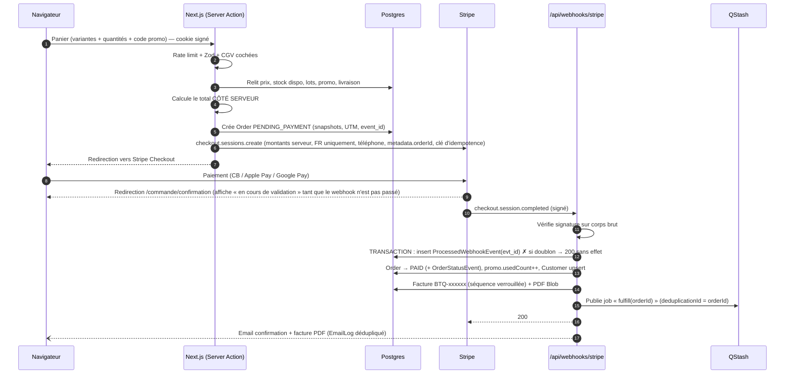
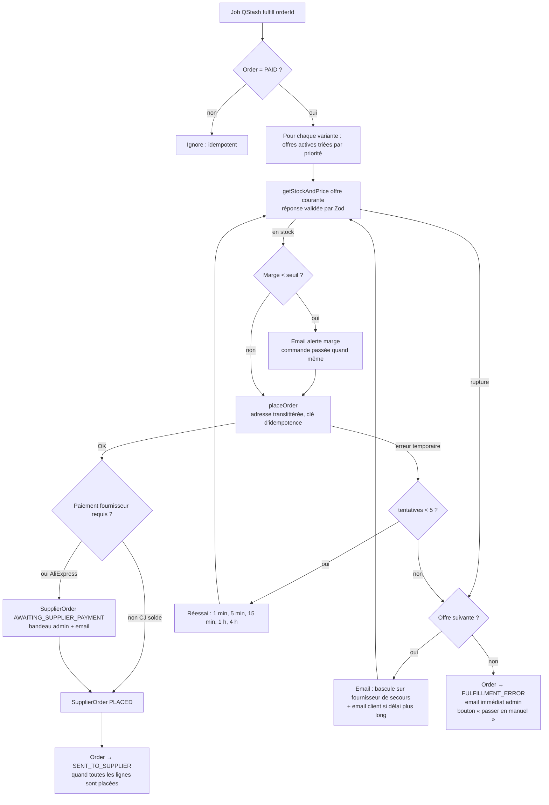
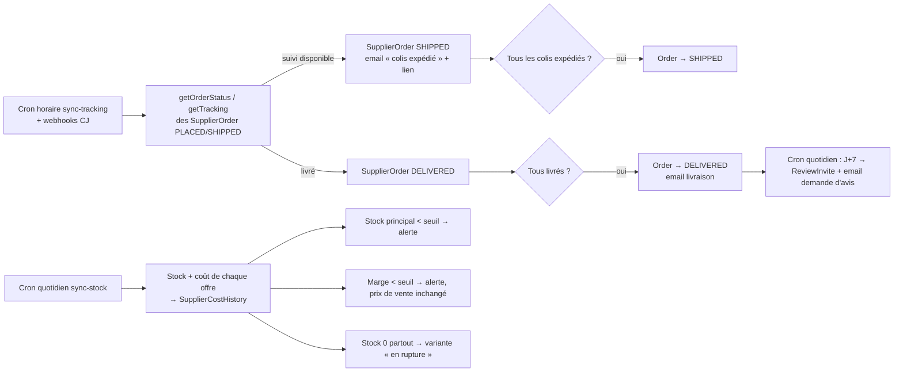
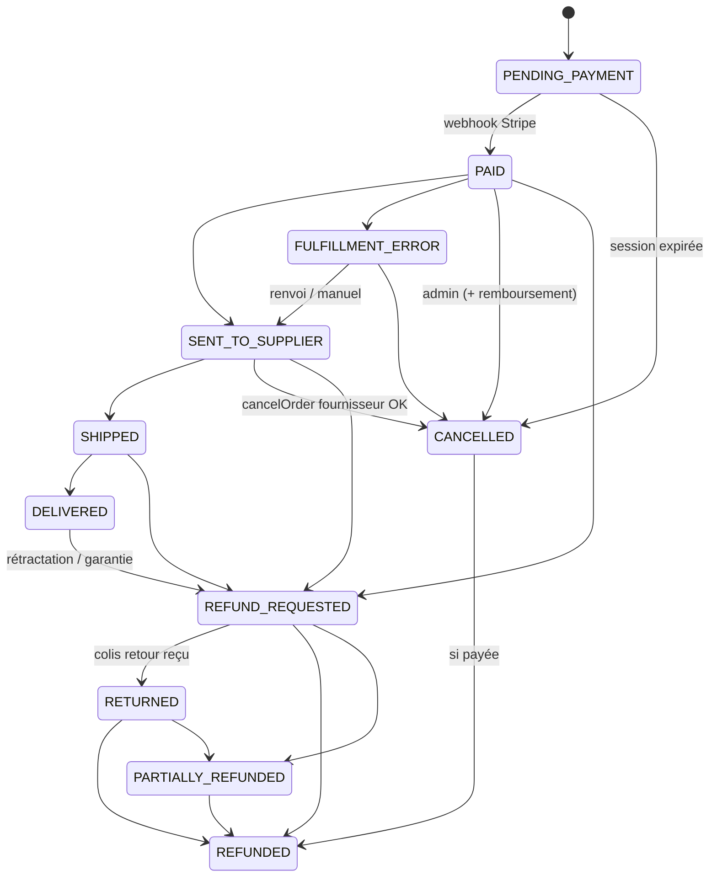

# Phase 0 — Cadrage

> Document de proposition, à valider avant toute ligne de code.
> Rédigé le 2026-10-01 après vérification des versions et docs actuelles.

---

## 1. Ce que la vérification des docs a changé par rapport au cahier des charges

| Sujet                  | Constat (octobre 2026)                                                                                                                                                                                                                                                                                                                                                                                                                                          | Conséquence proposée                                                                                                                                        |
| ---------------------- | --------------------------------------------------------------------------------------------------------------------------------------------------------------------------------------------------------------------------------------------------------------------------------------------------------------------------------------------------------------------------------------------------------------------------------------------------------------- | ----------------------------------------------------------------------------------------------------------------------------------------------------------- |
| **Next.js**            | Stable : **16.3.x**. `middleware.ts` est remplacé par **`proxy.ts`** (runtime Node.js).                                                                                                                                                                                                                                                                                                                                                                         | Next 16, `proxy.ts` pour la CSP à nonce et le masquage du chemin admin.                                                                                     |
| **Prisma**             | Stable : **7.10** (la 8 est en RC → exclue). Prisma 7 impose un **driver adapter** (`@prisma/adapter-pg` / `@prisma/adapter-neon`), un **`prisma.config.ts`**, le générateur `prisma-client` avec `output` obligatoire, et ne charge plus `.env` seul.                                                                                                                                                                                                          | Prisma 7.10 + adapter Neon/pg.                                                                                                                              |
| **Auth.js (NextAuth)** | **v5 n'est jamais sorti en stable** (5.0.0-beta.32). Le projet est passé sous la maintenance de **Better Auth** (sept. 2025), en mode « correctifs de sécurité uniquement » ; les mainteneurs recommandent Better Auth pour les nouveaux projets.                                                                                                                                                                                                               | **Je recommande Better Auth** (plugin `twoFactor` TOTP + codes de secours natifs, rate limiting intégré, adapter Prisma). → **Question Q1**.                |
| **Stripe**             | SDK Node 23.x, versions d'API nommées (`2026-xx-xx.dahlia/endive`). `shipping_address_collection.allowed_countries: ["FR"]` et `phone_number_collection.enabled` disponibles.                                                                                                                                                                                                                                                                                   | Version d'API **épinglée** dans le code ; vérifiée au moment de la phase 3.                                                                                 |
| **API AliExpress DS**  | Accès soumis à **validation de l'application** par AliExpress. Méthodes : `aliexpress.ds.product.get`, `aliexpress.ds.shipping.calculate` (fret), `aliexpress.ds.order.create`, + suivi commande/tracking. OAuth avec access/refresh token. **Le paiement n'est PAS automatique** : la commande créée par API reste « en attente de paiement » sur le compte AliExpress, à payer à la main (en lot). Adresses : **caractères latins non accentués uniquement**. | Statut fournisseur `AWAITING_SUPPLIER_PAYMENT` affiché clairement dans l'admin (exigence 5.2.6) + translittération des adresses (é → e). → **Question Q4**. |
| **CJ Dropshipping**    | API v2 : `POST /api2.0/v1/authentication/getAccessToken` (token 180 j, refresh 180 j), `createOrderV2`, webhooks (commande, suivi, stock). Paiement possible **par solde de portefeuille CJ** (donc automatisable).                                                                                                                                                                                                                                             | Adaptateur CJ complet ; webhooks CJ en plus du cron.                                                                                                        |
| **Vercel**             | Le plan **Hobby interdit l'usage commercial** et limite les crons à 1 fois/jour. Le cron horaire exigé (5.2.4) nécessite **Pro**.                                                                                                                                                                                                                                                                                                                               | Vercel **Pro** obligatoire (≈ 20 $/mois). → **Q3**.                                                                                                         |
| Autres                 | Zod **4.6**, Tailwind **4.3**, Vitest **5.0**, Playwright **1.63**, `@sentry/nextjs` **11.2**, Resend **6.31**, React Email **1.0**, `@react-pdf/renderer` **4.9**, Upstash Ratelimit **2.2** / QStash **2.12**, Vercel Blob **2.8**. Node 22 en local : OK.                                                                                                                                                                                                    | Versions épinglées dans `package.json` + lockfile.                                                                                                          |

---

## 2bis. Décisions validées (2026-10-01)

| #   | Décision                                                                                                                                                                                            |
| --- | --------------------------------------------------------------------------------------------------------------------------------------------------------------------------------------------------- |
| Q1  | **Better Auth**, email + mot de passe + **TOTP obligatoire** + codes de secours.                                                                                                                    |
| Q2  | **Neon**, région Francfort (`eu-central-1`) ; plan payant avant la prod (PITR).                                                                                                                     |
| Q3  | **Vercel Pro**, fonctions en **`fra1`**.                                                                                                                                                            |
| Q4  | Modèle « Shopify + DSers » : **AliExpress principal** (commande créée automatiquement par API, paiement en un clic / en lot sur AliExpress, signalé dans l'admin + email), CJ et Manuel en secours. |
| Q5  | **pnpm** ; dépôt GitHub **privé créé avec `gh`** (push soumis à accord).                                                                                                                            |
| Q6  | Aucune identité : placeholders `[À COMPLÉTER]`, design neutre premium.                                                                                                                              |
| Q7  | Livraison **4,90 €**, gratuite dès **49 €** (modifiable).                                                                                                                                           |
| Q8  | Retour à l'adresse de Matthieu en France, **frais de retour à la charge du client** (mention CGV).                                                                                                  |
| Q9  | Offres « 2 coussins = −10 % » et « M + L = −5 € » **créées mais désactivées** ; une seule remise de lot par panier (la plus avantageuse).                                                           |
| Q10 | Prix L, coûts d'achat et port saisis par Matthieu dans l'admin ; seed fictif en dev uniquement.                                                                                                     |
| Q11 | Multi-colis : **1 email par colis** ; `SHIPPED` quand tous partis, `DELIVERED` quand tous livrés.                                                                                                   |
| Q12 | Bascule : 5 réessais (1 min → 4 h), rupture = bascule immédiate, épuisement = `FULFILLMENT_ERROR` ; **email auto au client** si délai allongé.                                                      |
| Q13 | Série dédiée à la boutique **`BTQ-000001`**, continue, sans remise annuelle ; avoirs **`BTQ-AV-000001`** (séries distinctes admises par le BOFiP ; à confirmer par un comptable).                   |
| Q14 | Livre des recettes : date de paiement client **et** date de virement Stripe exportées ; filtre par défaut sur la date de paiement.                                                                  |
| Q15 | Conservation : comptable 10 ans, prospects 3 ans, contact 1 an, audit 1 an, logs 30 j, consentement cookies 6 mois. Effacement RGPD = anonymisation, factures conservées.                           |
| Q16 | Alertes **par email uniquement**.                                                                                                                                                                   |

## 2. Questions (toutes en une fois)

Les questions marquées ★ sont **bloquantes** pour la phase 1 ; les autres peuvent recevoir un placeholder.

1. ★ **Authentification admin** : OK pour **Better Auth** à la place d'Auth.js (raison ci-dessus) ? Et mode de connexion : **email + mot de passe + TOTP** (je recommande : ne dépend pas de la délivrabilité email) ou **lien magique + TOTP** ?
2. ★ **Base de données** : **Neon** (Francfort, `eu-central-1`) ou Supabase ? Je recommande Neon (Postgres pur, branches pour les previews, intégration Vercel). Attention : la rétention de restauration (PITR) du plan gratuit est courte → plan payant conseillé avant la prod.
3. ★ **Vercel Pro** : OK pour ce coût ? Région des fonctions : **`cdg1` (Paris)** ou `fra1` (Francfort, collée à Neon → latence DB plus faible, je recommande `fra1`) ?
4. ★ **Fournisseur principal et paiement** : as-tu déjà un compte développeur **AliExpress Open Platform** (app approuvée) ? Sachant que **chaque commande AliExpress devra être payée à la main** sur AliExpress (l'API ne paie pas), préfères-tu :
   a) AliExpress en principal (paiement manuel signalé dans l'admin + email), CJ en secours ;
   b) **CJ en principal** si le produit y est référencé (paiement automatique par solde), AliExpress en secours ;
   c) Manuel uniquement au lancement, API branchées dès que les accès sont obtenus.
5. ★ **Gestionnaire de paquets et Git** : `pnpm` (je recommande) ou `npm` ? Je fais `git init` en phase 1 ; dois-je créer un dépôt GitHub **privé** avec `gh` (et sous quel compte/organisation), ou tu le crées toi-même ?
6. **Nom de la boutique, domaine, logo, couleurs** : existent-ils déjà ? Sinon placeholders + design neutre (crème / brun chaud / vert sauge, typographie serif pour les titres).
7. **Livraison client** : tarif proposé par défaut ? (ex. 4,90 €, gratuite dès 49 €) — tout restera modifiable dans l'admin. Un seul tarif « Livraison standard suivie » au lancement, ou plusieurs (point relais / domicile) ?
8. **Retours / rétractation** : le renvoi en Chine n'est pas réaliste. Proposition : retour **à ton adresse en France**, **frais de retour à la charge du client** (à indiquer clairement dans les CGV, sinon ils sont pour toi). D'accord ? Quelle adresse de retour (placeholder sinon) ?
9. **Offres par lot de départ** : quelles offres veux-tu au lancement ? (ex. « 2 coussins = −10 % », « M + L = −5 € »). Placeholder désactivé sinon.
10. **Prix de la taille L, prix d'achat L, frais de port réels fournisseur** : tu les saisiras dans l'admin, confirmes-tu ? (seed de dev uniquement avec des valeurs fictives clairement marquées, jamais en prod).
11. **Commande mixte M + L chez deux fournisseurs** → deux colis, deux numéros de suivi. Proposition : la commande passe `SHIPPED` quand **tous** les colis sont expédiés ; l'email client est envoyé **à chaque colis** (« colis 1/2 expédié »). D'accord ?
12. **Bascule fournisseur** : proposition = erreur temporaire → 5 réessais (1 min, 5 min, 15 min, 1 h, 4 h) sur la même offre ; **rupture** → bascule immédiate sur l'offre suivante ; toutes les offres épuisées → `FULFILLMENT_ERROR` + email. Si le fournisseur de secours a un délai plus long que celui affiché au client lors de l'achat, je propose un **email d'information au client** avec le nouveau délai (obligation d'information, et respect du délai max des CGV). D'accord ?
13. **Factures** : numérotation continue proposée `F-000001` (sans remise à zéro annuelle) et avoirs `AV-000001` dans une série distincte. Ça te va ?
14. **Livre des recettes** : date d'encaissement = **date du paiement Stripe** (et non date du virement Stripe vers ta banque) — c'est l'usage pour la vente en ligne, à confirmer avec ton comptable si tu en as un.
15. **Durées de conservation** proposées : clients sans commande / prospects 3 ans après dernier contact ; commandes et factures 10 ans (anonymisées si demande RGPD) ; messages de contact 1 an ; logs techniques et journaux de rate limiting 30 j ; journal d'audit admin 1 an ; preuves de consentement cookies 13 mois. OK ?
16. **Alertes admin** : une seule adresse (`ADMIN_ALERT_EMAIL`) ; veux-tu aussi une notification **push** (ex. ntfy/Telegram) pour les paiements fournisseur en attente ? (optionnel, désactivé par défaut)

---

## 3. Arborescence proposée

```
coussin/
├── .github/
│   ├── workflows/ci.yml              # lint, typecheck, vitest, playwright, npm audit
│   └── dependabot.yml
├── docs/
│   ├── ARCHITECTURE.md  SECURITY.md  RGPD.md  RESTAURATION.md  PHASE0_CADRAGE.md
├── prisma/
│   ├── schema.prisma
│   ├── migrations/                   # dont triggers SQL d'immuabilité des factures
│   └── seed.dev.ts                   # refuse de tourner si NODE_ENV=production
├── prisma.config.ts
├── public/                           # favicon, robots statiques éventuels (pas d'uploads)
├── src/
│   ├── proxy.ts                      # CSP nonce, en-têtes, réécriture du chemin admin secret
│   ├── instrumentation.ts            # Sentry (serveur)
│   ├── app/
│   │   ├── (shop)/
│   │   │   ├── page.tsx              # page produit = accueil
│   │   │   ├── panier/page.tsx
│   │   │   ├── commande/confirmation/page.tsx
│   │   │   ├── suivi/page.tsx
│   │   │   ├── retractation/page.tsx
│   │   │   ├── avis/[token]/page.tsx # dépôt d'avis (lien reçu par email)
│   │   │   └── contact/page.tsx
│   │   ├── (legal)/
│   │   │   ├── mentions-legales/  cgv/  confidentialite/  cookies/  avis-clients/  # page « comment les avis sont contrôlés »
│   │   ├── admin/                    # inaccessible directement ; servi via /<ADMIN_PATH> (proxy)
│   │   │   ├── login/  2fa/
│   │   │   ├── (protected)/
│   │   │   │   ├── page.tsx          # tableau de bord
│   │   │   │   ├── commandes/[id]/  produit/  fournisseurs/  clients/[id]/
│   │   │   │   ├── promos/  livraison/  lots/  avis/  factures/
│   │   │   │   ├── comptabilite/     # exports CSV, seuils
│   │   │   │   ├── reglages/  audit/
│   │   └── api/
│   │       ├── auth/[...all]/route.ts
│   │       ├── webhooks/stripe/route.ts
│   │       ├── webhooks/cj/route.ts
│   │       ├── jobs/fulfill/route.ts         # appelé par QStash (signature vérifiée)
│   │       ├── cron/{sync-tracking,sync-stock,retention,review-requests}/route.ts  # CRON_SECRET
│   │       └── invoices/[id]/route.ts        # PDF, admin ou lien signé client
│   │   ├── sitemap.ts  robots.ts  layout.tsx  not-found.tsx
│   ├── components/{ui,shop,admin,consent}/
│   ├── emails/                       # templates React Email
│   ├── server/                       # code exclusivement serveur (`import "server-only"`)
│   │   ├── db.ts  env.ts             # env validé par Zod au démarrage
│   │   ├── auth/                     # Better Auth, garde requireAdmin()
│   │   ├── pricing/                  # calcul panier, lots, promo, livraison, TVA (pur, testé)
│   │   ├── checkout/  stripe/  invoices/  emails/
│   │   ├── orders/state-machine.ts   # transitions autorisées + journalisation
│   │   ├── fulfillment/
│   │   │   ├── adapter.ts            # interface SupplierAdapter + types Zod
│   │   │   ├── adapters/{aliexpress,cj,manual}.ts
│   │   │   ├── select-offer.ts  dispatch.ts  sync.ts
│   │   ├── accounting/  gdpr/  reviews/  audit/  alerts/
│   │   ├── security/{ratelimit,turnstile,crypto}.ts
│   │   └── marketing/{tiktok,meta,utm}.ts
│   ├── lib/                          # code partagé client/serveur sans secret (format €, schémas Zod publics)
│   └── styles/
├── tests/{unit,e2e}/
├── .env.example  README.md  TODO_MATTHIEU.md  vercel.json
```

Principes : tout le métier vit dans `src/server/**` (marqué `server-only`) en fonctions pures testables ; les Server Actions et routes ne font que valider (Zod) → autoriser → appeler le métier.

---

## 4. Schéma de base de données (Prisma 7)

Conventions : montants en **centimes (Int)**, jamais de float ; identifiants `cuid`; snapshots (prix, adresse, libellé) figés sur la commande et la facture ; les tables Better Auth (`User`, `Session`, `Account`, `Verification`, `TwoFactor`) sont générées par son CLI et étendues d'un champ `role`.

```prisma
generator client {
  provider = "prisma-client"
  output   = "../src/generated/prisma"
}

datasource db {
  provider = "postgresql"
  // URL dans prisma.config.ts (Prisma 7)
}

// ───────────── Réglages ─────────────

enum TaxMode { FRANCHISE_293B STANDARD }

/// Ligne unique (id = "singleton"). Tous les seuils sont saisis dans l'admin, jamais codés en dur.
model ShopSettings {
  id                         String   @id @default("singleton")
  shopName                   String   // "[À COMPLÉTER]"
  legalIdentity              Json     // nom, SIRET, adresse, email, hébergeur, médiateur…
  taxMode                    TaxMode  @default(FRANCHISE_293B)
  defaultTaxRateBps          Int      @default(0)      // 2000 = 20 % le jour où la TVA s'applique
  christmasBannerEnabled     Boolean  @default(false)
  christmasBannerText        String?
  marginAlertThresholdBps    Int      @default(3000)   // alerte si marge < 30 %
  lowStockThreshold          Int      @default(10)
  microRevenueCeilingCents   Int?                      // plafond micro BIC vente
  vatFranchiseThresholdCents Int?                      // seuil franchise TVA
  thresholdAlertRatioBps     Int      @default(8000)   // alerte à 80 % des seuils
  cgvVersion                 String
  updatedAt                  DateTime @updatedAt
}

// ───────────── Catalogue ─────────────

enum SupplierAdapterKind { ALIEXPRESS CJ MANUAL }
enum MediaKind { IMAGE VIDEO }

model Product {
  id                  String   @id @default(cuid())
  slug                String   @unique
  name                String
  tagline             String
  contentBlocks       Json     // blocs éditoriaux (fonctionnement, bénéfices, entretien, FAQ…), validés par Zod
  sizeGuide           Json
  packageContents     String
  textileComposition  String?
  careInstructions    String?
  sortingInstructions String?  // marquage tri / REP, rempli après vérification
  // GPSR
  manufacturerName    String?
  manufacturerAddress String?
  manufacturerContact String?
  euResponsibleName   String?
  euResponsibleAddress String?
  euResponsibleContact String?
  productReference    String?
  safetyWarnings      String?
  defaultAdapter      SupplierAdapterKind @default(MANUAL)  // adaptateur par défaut par produit
  active              Boolean  @default(false)
  media               ProductMedia[]
  variants            Variant[]
  createdAt           DateTime @default(now())
  updatedAt           DateTime @updatedAt
}

model ProductMedia {
  id        String    @id @default(cuid())
  productId String
  product   Product   @relation(fields: [productId], references: [id], onDelete: Cascade)
  kind      MediaKind
  blobUrl   String    // Vercel Blob
  posterUrl String?
  alt       String
  width     Int
  height    Int
  position  Int
  @@index([productId, position])
}

model Variant {
  id               String   @id @default(cuid())
  productId        String
  product          Product  @relation(fields: [productId], references: [id])
  sku              String   @unique
  label            String   // "M — 60 × 48 cm"
  widthCm          Int
  lengthCm         Int
  recommendedFor   String   // "Chats et petits chiens jusqu'à ~8 kg"
  priceCents       Int
  showReferencePrice Boolean @default(false) // le prix barré est CALCULÉ (plus bas prix des 30 j précédents), jamais saisi
  position         Int
  active           Boolean  @default(true)
  priceHistory     SalePriceHistory[]
  offers           SupplierOffer[]
  orderItems       OrderItem[]
}

/// Historique du prix de VENTE : sert à calculer le prix de référence légal (directive Omnibus).
model SalePriceHistory {
  id         String   @id @default(cuid())
  variantId  String
  variant    Variant  @relation(fields: [variantId], references: [id])
  priceCents Int
  validFrom  DateTime @default(now())
  @@index([variantId, validFrom])
}

/// Une offre fournisseur pour une taille, classée par priorité (1 = principale).
model SupplierOffer {
  id                 String   @id @default(cuid())
  variantId          String
  variant            Variant  @relation(fields: [variantId], references: [id])
  adapter            SupplierAdapterKind
  supplierName       String
  externalProductId  String?
  externalSkuId      String?
  externalUrl        String?
  priority           Int
  purchaseCostCents  Int
  shippingCostCents  Int
  deliveryDaysMin    Int
  deliveryDaysMax    Int      // c'est CETTE valeur qui alimente le délai affiché
  lastKnownStock     Int?
  lastSyncedAt       DateTime?
  lastSyncError      String?
  active             Boolean  @default(true)
  costHistory        SupplierCostHistory[]
  supplierOrders     SupplierOrder[]
  @@unique([variantId, priority])
}

model SupplierCostHistory {
  id                String   @id @default(cuid())
  offerId           String
  offer             SupplierOffer @relation(fields: [offerId], references: [id])
  purchaseCostCents Int
  shippingCostCents Int
  stock             Int?
  recordedAt        DateTime @default(now())
  @@index([offerId, recordedAt])
}

// ───────────── Promotions & livraison ─────────────

enum DiscountType { PERCENT FIXED }
enum BundleKind { QUANTITY COMBO }

model BundleOffer {
  id            String       @id @default(cuid())
  name          String
  kind          BundleKind   // QUANTITY : N pièces quelconques ; COMBO : variantes précises
  minQuantity   Int?
  comboVariantIds String[]
  discountType  DiscountType
  discountValue Int          // bps si PERCENT, centimes si FIXED
  active        Boolean      @default(false)
  startsAt      DateTime?
  endsAt        DateTime?
}

model PromoCode {
  id               String       @id @default(cuid())
  code             String       @unique // stocké en majuscules
  discountType     DiscountType
  discountValue    Int
  minSubtotalCents Int?
  maxUses          Int?
  usedCount        Int          @default(0)  // incrémenté dans la transaction du webhook
  startsAt         DateTime?
  expiresAt        DateTime?
  active           Boolean      @default(true)
  orders           Order[]
}

model ShippingRate {
  id                   String  @id @default(cuid())
  name                 String
  country              String  @default("FR")
  priceCents           Int
  freeAboveCents       Int?
  active               Boolean @default(true)
}

// ───────────── Clients & commandes ─────────────

model Customer {
  id           String    @id @default(cuid())
  email        String    @unique   // normalisé en minuscules
  firstName    String?
  lastName     String?
  phone        String?
  anonymizedAt DateTime?
  createdAt    DateTime  @default(now())
  lastActivityAt DateTime @default(now())
  orders       Order[]
}

enum OrderStatus {
  PENDING_PAYMENT PAID SENT_TO_SUPPLIER SHIPPED DELIVERED
  FULFILLMENT_ERROR CANCELLED REFUND_REQUESTED REFUNDED PARTIALLY_REFUNDED RETURNED
}

model Order {
  id                     String      @id @default(cuid())
  number                 String      @unique   // "C-2026-00042", donné au client
  status                 OrderStatus @default(PENDING_PAYMENT)
  customerId             String?
  customer               Customer?   @relation(fields: [customerId], references: [id])
  email                  String      // snapshot (anonymisable)
  shippingName           String?
  shippingLine1          String?
  shippingLine2          String?
  shippingPostalCode     String?
  shippingCity           String?
  shippingCountry        String      @default("FR")
  phone                  String?
  subtotalCents          Int
  bundleDiscountCents    Int         @default(0)
  promoDiscountCents     Int         @default(0)
  shippingCents          Int
  taxCents               Int         @default(0)
  totalCents             Int
  taxMode                TaxMode
  currency               String      @default("EUR")
  promoCodeId            String?
  promoCode              PromoCode?  @relation(fields: [promoCodeId], references: [id])
  stripeCheckoutSessionId String?    @unique
  stripePaymentIntentId  String?     @unique
  paymentMethodType      String?     // card / apple_pay / google_pay (livre des recettes)
  paidAt                 DateTime?
  estimatedDeliveryMax   DateTime?   // délai annoncé au moment de l'achat
  cgvAcceptedAt          DateTime?
  cgvVersion             String?
  utmSource              String?
  utmMedium              String?
  utmCampaign            String?
  utmContent             String?
  utmTerm                String?
  ttclid                 String?
  marketingEventId       String?     // déduplication pixel / Events API
  deliveredAt            DateTime?
  createdAt              DateTime    @default(now())
  updatedAt              DateTime    @updatedAt
  items                  OrderItem[]
  statusEvents           OrderStatusEvent[]
  supplierOrders         SupplierOrder[]
  invoices               Invoice[]
  refunds                Refund[]
  notes                  OrderNote[]
  emails                 EmailLog[]
  withdrawals            WithdrawalRequest[]
  @@index([status, createdAt])
  @@index([paidAt])
}

model OrderItem {
  id               String   @id @default(cuid())
  orderId          String
  order            Order    @relation(fields: [orderId], references: [id])
  variantId        String
  variant          Variant  @relation(fields: [variantId], references: [id])
  productName      String   // snapshots
  variantLabel     String
  sku              String
  quantity         Int
  unitPriceCents   Int
  discountCents    Int      @default(0)
  unitCostCents    Int?     // coût réel connu à la commande fournisseur (marge)
  supplierOrderId  String?
  supplierOrder    SupplierOrder? @relation(fields: [supplierOrderId], references: [id])
  review           Review?
}

enum ActorType { SYSTEM WEBHOOK CRON ADMIN CUSTOMER }

model OrderStatusEvent {
  id         String      @id @default(cuid())
  orderId    String
  order      Order       @relation(fields: [orderId], references: [id])
  fromStatus OrderStatus?
  toStatus   OrderStatus
  actorType  ActorType
  actorId    String?
  reason     String
  createdAt  DateTime    @default(now())
  @@index([orderId, createdAt])
}

model OrderNote {
  id        String   @id @default(cuid())
  orderId   String
  order     Order    @relation(fields: [orderId], references: [id])
  authorId  String
  body      String
  createdAt DateTime @default(now())
}

// ───────────── Fulfillment ─────────────

enum SupplierOrderStatus {
  QUEUED PLACING AWAITING_SUPPLIER_PAYMENT PLACED SHIPPED DELIVERED FAILED CANCELLED
}

/// Une commande fournisseur = un colis. Une commande client peut en avoir plusieurs (M chez A, L chez B).
model SupplierOrder {
  id               String   @id @default(cuid())
  orderId          String
  order            Order    @relation(fields: [orderId], references: [id])
  offerId          String
  offer            SupplierOffer @relation(fields: [offerId], references: [id])
  adapter          SupplierAdapterKind
  idempotencyKey   String   @unique   // orderId + offerId + tentative de bascule
  status           SupplierOrderStatus @default(QUEUED)
  externalOrderId  String?
  attempts         Int      @default(0)
  nextAttemptAt    DateTime?
  lastError        String?
  costCents        Int?
  trackingNumber   String?
  carrier          String?
  trackingUrl      String?
  shippedAt        DateTime?
  deliveredAt      DateTime?
  lastPolledAt     DateTime?
  createdAt        DateTime @default(now())
  updatedAt        DateTime @updatedAt
  items            OrderItem[]
  purchase         PurchaseRecord?
  @@index([status, lastPolledAt])
}

/// Registre des achats (obligatoire pour l'activité de vente).
model PurchaseRecord {
  id              String   @id @default(cuid())
  supplierOrderId String?  @unique
  supplierOrder   SupplierOrder? @relation(fields: [supplierOrderId], references: [id])
  date            DateTime
  supplierName    String
  reference       String
  description     String
  amountCents     Int
  paymentMethod   String
  createdAt       DateTime @default(now())
}

// ───────────── Paiement, factures, remboursements ─────────────

/// Idempotence des webhooks : l'insertion échoue si l'événement a déjà été traité.
model ProcessedWebhookEvent {
  id          String   @id     // evt_… (Stripe) ou identifiant CJ
  source      String
  type        String
  processedAt DateTime @default(now())
}

enum InvoiceType { INVOICE CREDIT_NOTE }

/// Immuable : un trigger Postgres refuse UPDATE/DELETE (hors anonymisation contrôlée, impossible ici : snapshot conservé 10 ans).
model Invoice {
  id               String      @id @default(cuid())
  type             InvoiceType
  number           String      @unique  // BTQ-000001 / BTQ-AV-000001
  orderId          String
  order            Order       @relation(fields: [orderId], references: [id])
  issuedAt         DateTime    @default(now())
  sellerSnapshot   Json
  customerSnapshot Json
  lines            Json
  totalCents       Int         // négatif pour un avoir
  taxCents         Int
  legalMention     String      // "TVA non applicable, art. 293 B du CGI"
  pdfBlobUrl       String
  pdfSha256        String
  relatedInvoiceId String?
  refund           Refund?
}

/// Compteur sans trou : incrémenté dans la même transaction que la création de la facture (SELECT … FOR UPDATE).
model InvoiceSequence {
  series     String @id   // "BTQ" | "BTQ-AV"
  lastNumber Int    @default(0)
}

enum RefundStatus { PENDING SUCCEEDED FAILED }

model Refund {
  id             String       @id @default(cuid())
  orderId        String
  order          Order        @relation(fields: [orderId], references: [id])
  stripeRefundId String?      @unique
  amountCents    Int
  reason         String
  status         RefundStatus @default(PENDING)
  creditNoteId   String?      @unique
  creditNote     Invoice?     @relation(fields: [creditNoteId], references: [id])
  adminId        String?
  refundedAt     DateTime?
  createdAt      DateTime     @default(now())
}

// ───────────── Après-vente ─────────────

enum WithdrawalStatus { RECEIVED ACCEPTED RETURN_RECEIVED REFUNDED REJECTED }

model WithdrawalRequest {
  id        String   @id @default(cuid())
  orderId   String
  order     Order    @relation(fields: [orderId], references: [id])
  message   String?
  status    WithdrawalStatus @default(RECEIVED)
  createdAt DateTime @default(now())
}

enum ReviewStatus { PENDING APPROVED REJECTED }

model Review {
  id             String   @id @default(cuid())
  orderItemId    String   @unique   // un avis = un article acheté (achat vérifié par construction)
  orderItem      OrderItem @relation(fields: [orderItemId], references: [id])
  displayName    String   // "Julie D."
  rating         Int      // 1..5, contrôlé par Zod + CHECK SQL
  body           String
  status         ReviewStatus @default(PENDING)
  moderationNote String?
  submittedAt    DateTime @default(now())
  publishedAt    DateTime?
}

/// Jeton de dépôt d'avis envoyé à J+7 ; seul le hash est stocké.
model ReviewInvite {
  id        String   @id @default(cuid())
  orderId   String   @unique
  tokenHash String   @unique
  expiresAt DateTime
  usedAt    DateTime?
}

model ContactMessage {
  id        String   @id @default(cuid())
  email     String
  name      String
  orderNumber String?
  body      String
  createdAt DateTime @default(now())   // purgé après 1 an
}

enum EmailType { ORDER_CONFIRMATION SHIPPED DELIVERED REVIEW_REQUEST REFUND DELAY_NOTICE WITHDRAWAL_ACK }

/// Évite tout double envoi (contrainte unique) et trace la délivrabilité.
model EmailLog {
  id        String    @id @default(cuid())
  orderId   String?
  order     Order?    @relation(fields: [orderId], references: [id])
  type      EmailType
  dedupKey  String    @unique   // ex. "SHIPPED:<supplierOrderId>"
  resendId  String?
  sentAt    DateTime  @default(now())
}

// ───────────── Sécurité & conformité ─────────────

model AuditLog {
  id         String   @id @default(cuid())
  actorId    String?
  action     String   // "admin.login", "order.refund", "product.price.update"…
  targetType String?
  targetId   String?
  metadata   Json?    // jamais de données perso en clair
  ipHash     String?
  createdAt  DateTime @default(now())
  @@index([createdAt])
}

/// Preuve de consentement cookies (CNIL) : identifiant aléatoire, sans donnée identifiante.
model ConsentRecord {
  id          String   @id @default(cuid())
  consentId   String
  choices     Json     // { analytics: false, ads: true }
  policyVersion String
  createdAt   DateTime @default(now())
}

// + tables Better Auth (User avec role, Session, Account, Verification, TwoFactor)
```

**Activation future de la TVA** : `taxMode` + `defaultTaxRateBps` en réglage, `taxCents` et `taxMode` figés sur chaque commande et facture ; le module `pricing` calcule HT/TVA/TTC selon le mode. Passer en `STANDARD` ne touche pas l'historique.

---

## 5. Flux

### 5.1 Commande et paiement



### 5.2 Fulfillment, bascule et réessais



### 5.3 Suivi et après-livraison



### 5.4 Machine à états



Toute transition passe par `transition(orderId, to, actor, reason)` : vérifie la table des transitions autorisées, met à jour le statut avec un verrou optimiste (`WHERE status = from`), écrit `OrderStatusEvent` dans la même transaction.

---

## 6. Choix techniques notables (résumé)

- **Chemin admin secret** : `ADMIN_PATH` (env) réécrit par `proxy.ts` vers `/admin` ; l'accès direct à `/admin` renvoie 404 ; `noindex` + absent du sitemap. L'autorisation reste vérifiée dans **chaque** Server Action (`requireAdmin()`), le proxy n'est qu'une première barrière.
- **Jobs** : QStash (réessais, signature vérifiée sur `/api/jobs/*`) + état durable en base (`SupplierOrder.attempts`) ; un cron de rattrapage relance les jobs perdus.
- **Prix barré** : jamais saisi ; calculé = plus bas prix pratiqué sur les 30 jours précédant une baisse, affiché seulement si l'admin l'active **et** si l'historique le justifie.
- **Factures** : PDF générés une fois (`@react-pdf/renderer`), stockés dans Vercel Blob (accès privé), hash SHA-256 en base ; immuabilité garantie par trigger SQL.
- **Panier** : cookie `HttpOnly` signé contenant uniquement `[{variantId, qty}]` et code promo saisi.
- **Données perso** : Sentry `sendDefaultPii: false` + `beforeSend` qui masque emails/adresses ; logs structurés sans PII ; IP stockées uniquement hachées (HMAC) pour l'audit.

---

## 7. Après validation

Je commencerai la **phase 1 (socle)** : `git init`, Next 16 + TS strict, ESLint/Prettier, Tailwind 4, Prisma 7 + Neon, env Zod, en-têtes de sécurité/CSP, CI GitHub Actions, Sentry, `.env.example`, `README.md`, `docs/ARCHITECTURE.md`, `TODO_MATTHIEU.md`.
